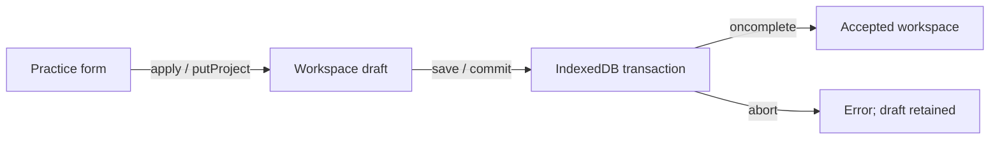

# Trace four kinds of state without mixing them

The application has a form, a workspace draft, an accepted workspace and persistent storage. Two counters participate: a practice project's `version` protects an edit against a changed project, while a workspace `revision` protects the persisted aggregate. They answer different questions.

## Worked example: apply then save

Assume accepted workspace W has revision 7 and Contact book has version 2. You open its form. The form carries version 2 as its expected project version. `putProject` validates the supplied workspace, compares that expected version with the current project, and returns a new workspace containing project version 3. It does not increment the persistent workspace revision or contact a server.

After Apply, the in-memory draft contains version 3 while accepted storage still contains version 2 at revision 7. Saving passes the draft plus the expected workspace identity and revision to `commit`. Inside the read/write transaction, storage reads the current accepted aggregate and compares W/7. If it matches and the transaction completes, the new accepted aggregate has revision 8.

| Moment | Form expectation | Draft project version | Accepted workspace revision |
|---|---:|---:|---:|
| Open form | 2 | 2 | 7 |
| Apply succeeds | Form closes | 3 | 7 |
| Save transaction completes | None | 3 | 8 |

This is an illustrative starting state, not a promise that a newly initialized workspace starts at revision 7. [storage.ts](../../src/storage.ts) initializes at revision 0 and increments successful ordinary saves of existing workspaces.

## Worked example: the losing tab

A and B both read W/7. A changes one project and commits W/8. B changes another project in its old draft and attempts to save expecting W/7. The comparison fails because accepted storage is now W/8. B's intended edit remains useful, but its aggregate also contains stale copies of unrelated data. Replacing storage with B's whole draft would erase A's accepted work.

A notification between tabs can help the interface respond, but it is not the concurrency control. Find the identity/revision comparison inside `commit`. If notifications were delayed, that transaction check would still reject the stale write. A reliable explanation names both the helpful notification and the actual write boundary.

## Worked example: successful request, aborted transaction

An IndexedDB `put` can report success before its transaction finishes. A later error can abort the transaction. Notice that `commit` resolves from `tx.oncomplete`, not a `put` success handler. If the UI accepted the draft on the earlier event, it could claim that data was saved even though a reload restored the prior accepted state.

## Replacement changes identity

Reviewed import/replacement preserves a recovery snapshot and creates a new workspace identity with revision 0. An old tab must not overwrite that new workspace merely because a revision number happens to match. This is why both identity and revision are checked. The ten-snapshot capacity is a deliberate refusal boundary, not permission to delete the oldest recovery data silently.

Try the [prediction worksheet](labs/README.md), then explain each answer in terms of a source function. The worksheet assesses these modeled states; real browser behavior still needs the application's browser checks.
