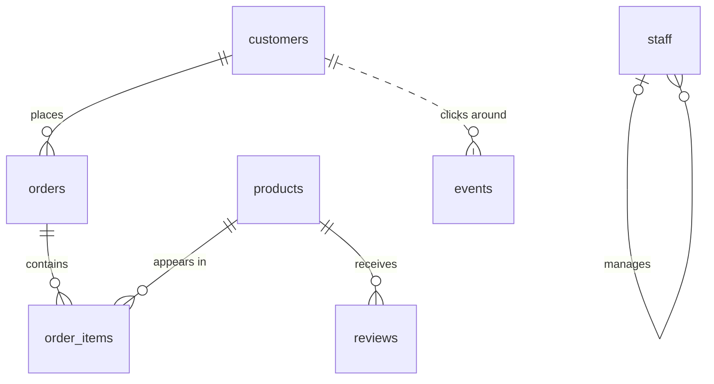

# The dataset

One PostgreSQL database, seven tables, modelling a small e-commerce shop:
customers place orders, orders contain items, items point at products,
products collect reviews, the storefront emits a clickstream of events, and
the company that runs it all has a staff org chart.

Every lesson runs against a throwaway clone of the same template
(`dojo_template`), so you can never break anything permanently. Exact row
counts and distributions live in [dataset_facts.md](dataset_facts.md), which
is regenerated by every `dojo seed` — lesson prose cites numbers from there.

## Relationships

(`events.customer_id` is *not* a declared foreign key — clickstreams arrive
too fast to check. That's deliberate, and it matters in Part 5.)

## Tables

### customers — 50,000 rows

| column | type | meaning |
|---|---|---|
| id | int PK | customer id |
| name | text | full name |
| email | text | always `user{id}@example.com` |
| country | text | ISO 3166-1 alpha-2 code (`US`, `GB`, ...) |
| created_at | timestamptz | signup time, spread over ~2 years |

### products — 10,000 rows

| column | type | meaning |
|---|---|---|
| id | int PK | product id |
| name | text | e.g. `Nova Kettle 812` |
| category | text | one of: books, electronics, garden, toys, clothing, food |
| price | numeric(10,2) | 1 to 500 |
| description | text | marketing blurb |
| attributes | jsonb | `{"color": ..., "size": ..., "tags": [...]}` — 5 colors, sizes s/m/l/xl, 2 tags |

### orders — 500,000 rows

| column | type | meaning |
|---|---|---|
| id | int PK | order id |
| customer_id | int FK → customers | who ordered (no index! see lesson 33) |
| status | text | pending / paid / shipped / cancelled (paid is ~50%) |
| total | numeric(10,2) | 5 to 2000 |
| created_at | timestamptz | spread over ~1 year |

### order_items — 1,000,000 rows

| column | type | meaning |
|---|---|---|
| id | int PK | line-item id |
| order_id | int FK → orders | parent order |
| product_id | int FK → products | which product |
| quantity | int | 1 to 5 |
| price | numeric(10,2) | unit price at order time (snapshot of the product's price) |

### reviews — 1,000,000 rows

| column | type | meaning |
|---|---|---|
| id | int PK | review id |
| product_id | int FK → products | reviewed product |
| rating | int | 1 to 5 |
| body | text | free text (Part 5 turns this into a full-text search corpus) |
| created_at | timestamptz | spread over ~1 year |

### events — 3,000,000 rows

| column | type | meaning |
|---|---|---|
| id | bigint PK | event id |
| customer_id | int | who (no FK, no index) |
| event_type | text | view / click / add_to_cart / purchase / logout (view dominates) |
| payload | jsonb | `{"path": "/p/<product id>", "value": 0..1000}` |
| ts | timestamptz | **strictly increasing with id** — one event per second. This physical ordering is why BRIN shines here (lesson 43) |

### staff — 500 rows

| column | type | meaning |
|---|---|---|
| id | int PK | employee id |
| name | text | full name |
| department | text | sales / support / engineering / ops / finance |
| manager_id | int FK → staff, NULL for the CEO | reporting line; the org tree is 4 levels deep |
| salary | numeric(10,2) | 40k–250k, higher nearer the top (with deliberate overlaps) |
| hired_on | date | spread over 10 years |

## Things worth knowing before Part 5

- **The template has no indexes beyond primary keys.** Every secondary index
  in this course is one you create yourself.
- Foreign-key columns (`orders.customer_id`, `order_items.order_id`, ...) are
  **not** automatically indexed by PostgreSQL. Lesson 33 turns this into a
  war story.
- The data is deterministic: fixed RNG seed, fixed epoch base, no `now()`.
  Your numbers match this course's numbers, on any machine.
